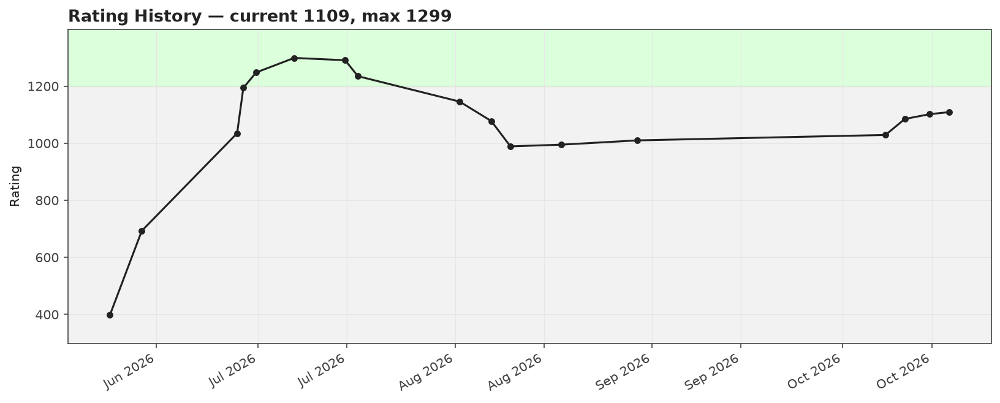
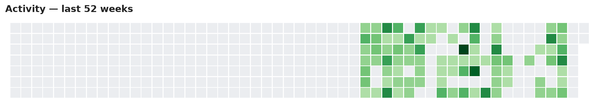
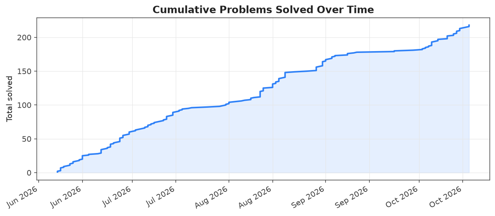
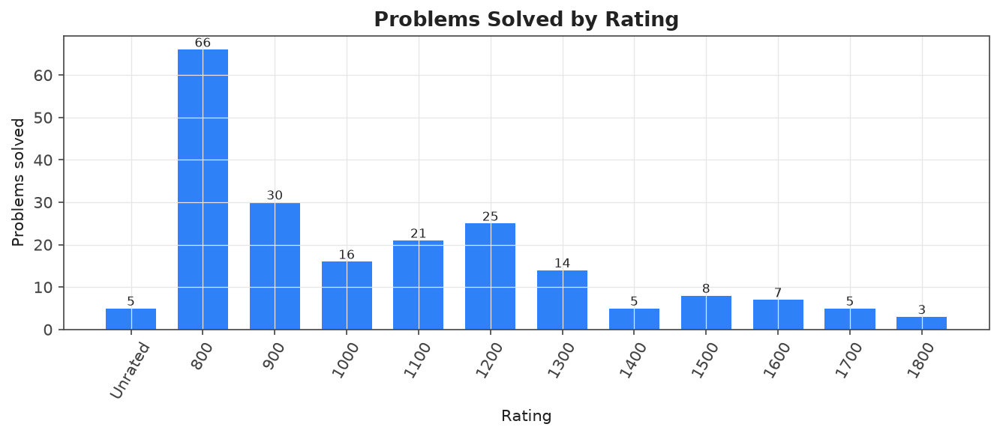
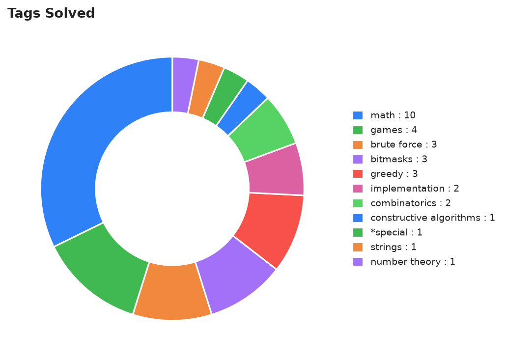
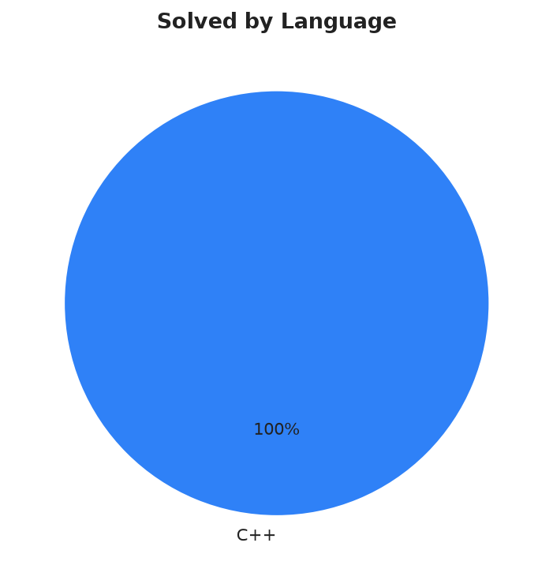
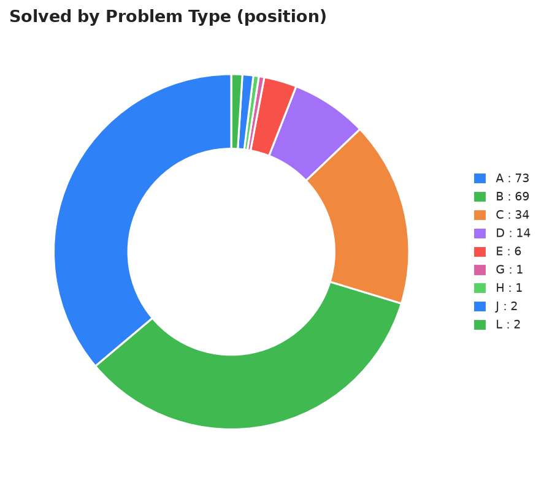

# CF Vault

Auto-generated archive of accepted Codeforces submissions for **[om_sharma_](https://codeforces.com/profile/om_sharma_)**.

- **Total solved:** 17
- **With source attached:** 0 / 17
- **Longest streak:** 6 days  |  **Current streak:** 0 days
- **Contest rating:** 1010 (max 1299)

## 📊 Analytics

📋 Raw tables (language / rating / tag breakdown)

### By language

| Language | Solved |
|---|---|
| C++ | 17 |

### By rating

| Rating | Count |
|---|---|
| 0800 | 7 |
| 1000 | 3 |
| 1100 | 3 |
| 1500 | 1 |
| 1700 | 1 |
| 1800 | 1 |
| Unrated | 1 |

### By tag

| Tag | Count |
|---|---|
| `math` | 10 |
| `games` | 4 |
| `brute force` | 3 |
| `bitmasks` | 3 |
| `greedy` | 3 |
| `implementation` | 2 |
| `combinatorics` | 2 |
| `constructive algorithms` | 1 |
| `*special` | 1 |
| `strings` | 1 |
| `number theory` | 1 |

## All problems

| # | Problem | Rating | Tags | Code | Link |
|---|---|---|---|---|---|
| 105669I | [Partition](problems/untagged/Unrated_105669I-Partition) | ? |  | — | [CF](https://codeforces.com/contest/105669/problem/I) |
| 1421A | [XORwice](problems/bitmasks/0800_1421A-XORwice) | 800 | `bitmasks`, `greedy`, `math` | — | [CF](https://codeforces.com/contest/1421/problem/A) |
| 1688A | [Cirno's Perfect Bitmasks Classroom](problems/bitmasks/0800_1688A-Cirnos-Perfect-Bitmasks-Classroom) | 800 | `bitmasks`, `brute force` | — | [CF](https://codeforces.com/contest/1688/problem/A) |
| 1769A | [Узкая дорога](problems/special/0800_1769A-Узкая-дорога) | 800 | `*special`, `math` | — | [CF](https://codeforces.com/contest/1769/problem/A) |
| 2261A | [Hey, It's Me, Souvlakity](problems/games/0800_2261A-Hey-Its-Me-Souvlakity) | 800 | `games`, `math` | — | [CF](https://codeforces.com/contest/2261/problem/A) |
| 2263A | [Min Max Game](problems/games/0800_2263A-Min-Max-Game) | 800 | `games` | — | [CF](https://codeforces.com/contest/2263/problem/A) |
| 2271A | [Robot Odd Moves](problems/constructive-algorithms/0800_2271A-Robot-Odd-Moves) | 800 | `constructive algorithms`, `math` | — | [CF](https://codeforces.com/contest/2271/problem/A) |
| 2276A | [Perfect Sandwiches](problems/greedy/0800_2276A-Perfect-Sandwiches) | 800 | `greedy`, `math` | — | [CF](https://codeforces.com/contest/2276/problem/A) |
| 2261C | [I Know About a Million Things](problems/games/1000_2261C-I-Know-About-a-Million-Things) | 1000 | `games`, `math` | — | [CF](https://codeforces.com/contest/2261/problem/C) |
| 2271B | [MEX Game](problems/games/1000_2271B-MEX-Game) | 1000 | `games` | — | [CF](https://codeforces.com/contest/2271/problem/B) |
| 2276B | [Replace and Compress](problems/implementation/1000_2276B-Replace-and-Compress) | 1000 | `implementation`, `strings` | — | [CF](https://codeforces.com/contest/2276/problem/B) |
| 252A | [Little Xor](problems/brute-force/1100_252A-Little-Xor) | 1100 | `brute force`, `implementation` | — | [CF](https://codeforces.com/contest/252/problem/A) |
| 2261B | [What's the Capital of France?](problems/bitmasks/1100_2261B-Whats-the-Capital-of-France) | 1100 | `bitmasks`, `greedy`, `math` | — | [CF](https://codeforces.com/contest/2261/problem/B) |
| 2276C | [Subarrays](problems/math/1100_2276C-Subarrays) | 1100 | `math`, `number theory` | — | [CF](https://codeforces.com/contest/2276/problem/C) |
| 1999F | [Expected Median](problems/combinatorics/1500_1999F-Expected-Median) | 1500 | `combinatorics`, `math` | — | [CF](https://codeforces.com/contest/1999/problem/F) |
| 32C | [Flea](problems/math/1700_32C-Flea) | 1700 | `math` | — | [CF](https://codeforces.com/contest/32/problem/C) |
| 300C | [Beautiful Numbers](problems/brute-force/1800_300C-Beautiful-Numbers) | 1800 | `brute force`, `combinatorics` | — | [CF](https://codeforces.com/contest/300/problem/C) |